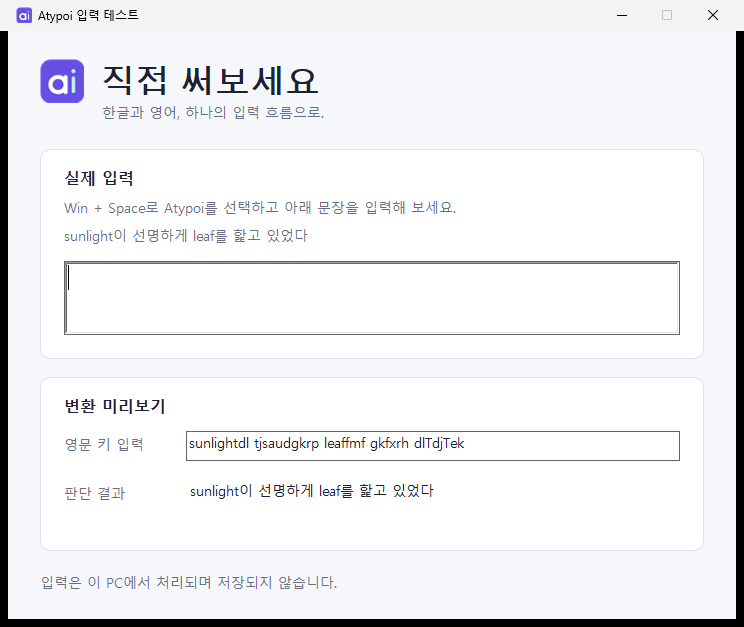
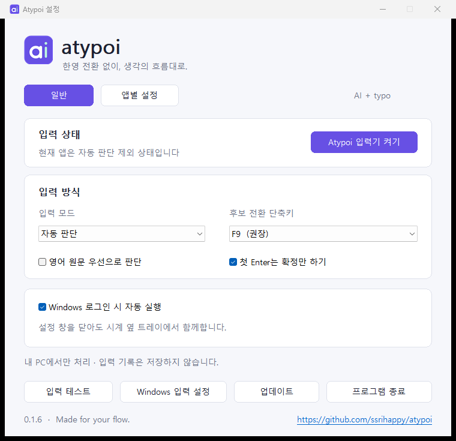

<p align="center"></p>
<h1 align="center">atypoi</h1>
<p align="center"><strong>한영 전환 없이, 생각의 흐름대로.</strong><br>AI + typo · Windows 한영 자동 입력기</p>
<p align="center"><a href="https://github.com/ssrihappy/atypoi/releases">다운로드</a> · <a href="docs/USAGE.md">사용 방법</a> · <a href="https://github.com/ssrihappy/atypoi/issues">문제 제보</a> · <a href="LICENSE">MIT</a></p>

한글과 영어를 섞어 쓸 때 전환 키를 누르는 수고를 줄여 줍니다. 시계 옆 트레이에 머무르는 네이티브 Windows 앱이며, 판단은 로컬 사전·통계 모델로 처리합니다. 외부 AI API나 계정이 필요하지 않습니다.

<p align="center"></p>

위 GIF는 실제 설치본에 가상 키와 스캔 코드로 입력한 화면입니다. 완성된 한글을 붙여넣거나 변환 결과를 합성하지 않았습니다.

| 입력한 키열 | 표시 결과 |
| --- | --- |
| `dkssud` | 안녕 |
| `hello` | hello |
| `githubdp APIfmf` | github에 API를 |
| `sunlightdl tjsaudgkrp leaffmf gkfxrh dlTdjTek` | sunlight이 선명하게 leaf를 핥고 있었다 |

`T`는 두벌식의 `Shift + ㅅ`입니다. 판단이 다르면 조합 중 `F9`로 후보를 바꿀 수 있습니다.

## 시작하기

1. [Releases](https://github.com/ssrihappy/atypoi/releases)의 `Atypoi.Setup.exe`를 실행합니다. 릴리스가 아직 없다면 아래 빌드 방법을 사용하세요.
2. 자동 실행·설치 후 실행을 선택하고 설치합니다. 입력기 등록에는 관리자 권한이 필요합니다.
3. **Atypoi 입력기 켜기**를 누르거나 `Win + Space`에서 Atypoi를 선택합니다.
4. **입력 테스트**에서 직접 입력해 보세요. 다른 프로그램은 **앱별 설정**에서 추가할 수 있습니다.

현재 버전은 **0.1.7**, Windows x64용 공개 빌드입니다. 설치 파일에는 게시자 서명이 없습니다.

0.1.7은 카카오톡 등 IMM 입력 앱의 조합 끊김과 공백·문장부호 누락을 개선합니다. 업데이트 후 **Atypoi 입력기 켜기**를 한 번 누르고 입력하던 앱을 완전히 종료한 뒤 다시 실행하세요. Windows 입력기 목록에서는 **영어(미국)의 Atypoi**로 표시되며 한글·영어 자동 입력 기능은 동일합니다. [변경 사항과 검증 범위](docs/RELEASE-NOTES.md)

앱은 GitHub의 최신 공개 릴리스를 자동으로 확인하고 다운로드합니다. 알림을 눌러 설치를 승인할 수 있으며, 트레이 메뉴에서 자동 확인을 끌 수 있습니다. 0.1.5-dev 이하 사용자는 이번 설치 파일을 한 번 직접 실행해 주세요.

<p align="center"></p>

## 주요 동작

- 한글·영어 자동 판단, 영어와 한국어 조사의 혼합 입력
- 자동·한글 고정·영문 고정·일시정지 모드
- 조합 중 `F9`로 후보 전환, 자모 단위 Backspace
- 앱별 허용·제외, 판단 방식과 Enter 동작 설정
- 트레이 상주와 로그인 시 자동 실행
- 입력 내용은 네트워크·클립보드·로그에 기록하지 않음

설정 창을 닫아도 트레이에서 동작합니다. 완전히 종료하려면 **프로그램 종료**를 누르세요. 트레이 실행과 입력기 선택은 별개이며, 다른 입력기가 선택된 동안에는 Atypoi가 변환하지 않습니다.

업데이트 후에는 사용 중이던 앱을 **완전히 종료한 뒤 다시 실행**하세요. 열린 앱은 이전 입력기 DLL을 계속 사용할 수 있습니다. 이전 설치의 입력기가 감지되면 설정과 트레이에서 재시작 안내를 표시합니다. `만들었다·깨끗했다·읽었다` 같은 과거형과 쌍자음·겹받침 조합은 별도 회귀 검사로 확인합니다.

## 지원 범위

Windows 메모장(스토어 버전), Google Chrome의 일반 설치 경로, 자체 입력 테스트 창을 기본 지원합니다. 다른 앱은 직접 추가해야 하며, 커스텀 편집기는 일부 기능이 제한될 수 있습니다. 비밀번호·이메일·URL·숫자 입력란과 읽기 전용 영역은 변환하지 않습니다.

x86·ARM64 앱, 관리자 앱과 모든 웹 편집기의 호환성은 검증하지 않았습니다. 독립 평가 데이터에 대한 판별 정확도 목표, 장시간 사용과 다중 모니터 시험도 남아 있습니다. [검증 범위](docs/INPUT-VERIFICATION.md)를 참고하세요.

## 빌드

Windows x64의 PowerShell에서 실행합니다. 컴파일러는 체크섬이 고정된 버전으로 `.tools`에 준비하며 시스템 PATH를 변경하지 않습니다.

```powershell
powershell -ExecutionPolicy Bypass -File scripts/bootstrap.ps1
powershell -ExecutionPolicy Bypass -File scripts/build.ps1
powershell -ExecutionPolicy Bypass -File scripts/package.ps1
```

`dist/Atypoi.exe`, `dist/Atypoi.IME.dll`, `dist/Atypoi.Setup.exe`가 생성됩니다. 빌드 시 코어·TSF 통합 검사도 실행합니다. 사전과 모델은 바이너리에 포함되어 실행 시 다운로드하지 않습니다.

설치 전 화면과 판단 엔진만 살펴보려면 `dist/Atypoi.exe --demo`를 실행하세요. 데모는 설정과 자동 시작을 저장하지 않으며 실제 앱 입력 변환에는 입력기 설치가 필요합니다.

## 프로젝트 구조

| 경로 | 역할 |
| --- | --- |
| `src/core` | 두벌식 조합·언어 판단·후보·입력 세션 |
| `src/ime` | Windows TSF 입력기 |
| `src/tray` | 설정·트레이·입력 테스트 UI |
| `src/setup` | 설치·업데이트 설치·제거 |
| `data` | 배포 모델 데이터 |
| `tests` | 코어·TSF 회귀 검사와 가상 입력 샘플 |
| `docs` | 사용·검증·브랜드·공개 가이드 |

## 기여와 배포

[기여 안내](CONTRIBUTING.md) · [사용 방법](docs/USAGE.md) · [개인정보 처리](docs/PRIVACY.md) · [GitHub 공개 방법](docs/PUBLISHING.md) · [브랜드 가이드](docs/BRAND.md)

GitHub Actions는 빌드·검사 후 설치 파일과 소스 ZIP을 보관합니다. 소스 버전과 일치하는 안정 버전 태그(예: `v0.1.7`)를 push하면 검사를 통과한 파일로 GitHub Release와 업데이트 피드를 함께 게시합니다. 일반 커밋과 PR은 공개 릴리스를 만들지 않습니다. 공개용 소스는 다음 명령으로 점검·내보낼 수 있습니다.

```powershell
powershell -ExecutionPolicy Bypass -File scripts/export-source.ps1
```

## 라이선스와 출처

[Code signing policy](docs/CODE-SIGNING.md): 무료 오픈소스 서명 신청을 접수했고 심사 대기 중입니다. 현재 v0.1.7은 서명되지 않았습니다.

소스와 브랜드 자산은 [MIT](LICENSE)로 배포합니다. macOS의 [Seamtype](https://github.com/aimdevlee/seamtype)을 바탕으로 Windows TSF 입력기를 구현했습니다. 사전·코퍼스·도구체인에는 각각의 라이선스가 적용되며, 저작권자와 기여자에 대한 고지는 [THIRD_PARTY_NOTICES.md](THIRD_PARTY_NOTICES.md)에 보존합니다.
