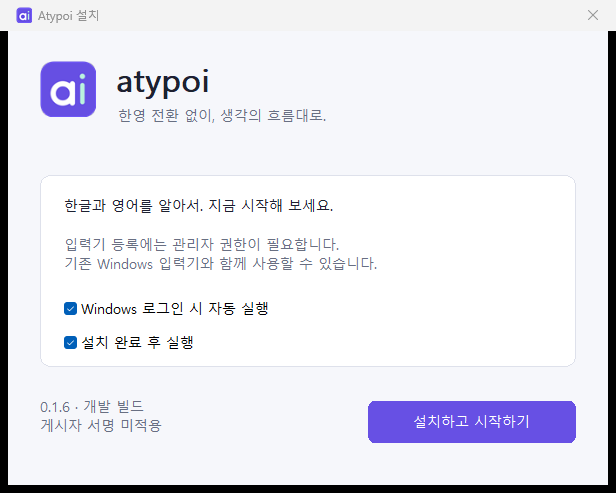
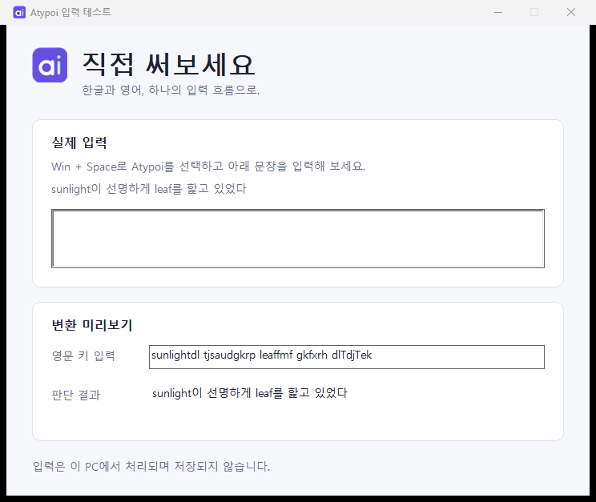
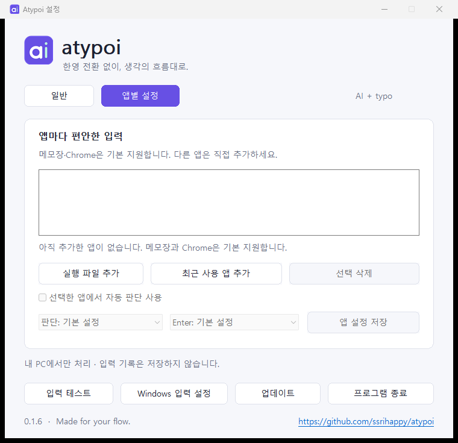

# Atypoi 사용 방법

Atypoi는 **AI + typo**를 합친 이름의 Windows 한영 자동 입력기입니다. 한글과 영어를 입력할 때 현재 키열을 판단하며, 입력 기록을 저장하지 않습니다.


## 1. 설치와 시작

1. [프로젝트 Releases](https://github.com/ssrihappy/atypoi/releases)에서 설치 파일 `Atypoi.Setup.exe`를 내려받습니다. 릴리스가 없다면 [README의 빌드 방법](../README.md#빌드)을 사용하세요.
2. 설치 파일을 실행하고 자동 실행·설치 후 실행 옵션을 선택합니다.
3. **설치하고 시작하기**를 누릅니다. 입력기 등록에 관리자 권한이 필요합니다.
4. 설치 후 설정에서 **Atypoi 입력기 켜기**를 누릅니다. `Win + Space`로 입력기 목록에서 직접 선택할 수도 있습니다.



트레이 앱이 실행 중이어도 다른 입력기를 선택하면 Atypoi가 입력을 변환하지 않습니다. 입력기 목록에 보이지 않으면 로그아웃 후 다시 로그인해 보세요.

## 2. 바로 입력해 보기

설정에서 **입력 테스트**를 누르고, 위쪽 **실제 입력** 칸을 클릭하세요. 두벌식 자판으로 다음 문장을 입력해 봅니다.

> sunlight이 선명하게 leaf를 핥고 있었다

영문 키 기준으로는 다음과 같습니다.

```text
sunlightdl tjsaudgkrp leaffmf gkfxrh dlTdjTek
```

대문자 `T`는 `Shift + ㅅ`으로 입력하는 쌍시옷입니다. `핥`의 ㄾ 받침은 ㄹ 다음 ㅌ을 입력합니다.



위쪽 입력란은 설치된 Windows 입력기의 동작을 확인합니다. 아래 **변환 미리보기**는 영문 키열에 대한 판단 결과를 보여줍니다. 두 영역은 독립적입니다.

## 3. 입력 키

| 키 | 동작 |
| --- | --- |
| `Space` | 조합 확정 후 공백 입력 |
| 첫 `Enter` | 기본 설정에서는 조합만 확정 |
| 다음 `Enter` | 앱에 Enter 전달 |
| `F9` | 조합 중 영어·혼합·한글 후보 전환 |
| `Backspace` | 현재 조합의 자모 삭제, 이전 완성 음절은 음절 단위로 삭제 |
| `Win + Space` | Windows 입력기 선택 |

오판이 있으면 **단어를 확정하기 전에 F9**를 누르세요. 선택한 후보는 해당 단어를 이어 입력하는 동안 유지됩니다. 이미 확정한 단어의 재변환 기능은 현재 포함하지 않습니다.

후보 단축키는 설정에서 `Ctrl + Shift + Space` 또는 해제로 바꿀 수 있습니다. Windows의 Ctrl+Shift 입력 전환과 충돌할 수 있어 F9를 권장합니다.

## 4. 일반 설정


| 설정 | 사용 방법 |
| --- | --- |
| 자동 판단 | 한글·영어를 입력 중에 판단 |
| 한글 고정 | 두벌식 한글로 조합 |
| 영문 고정 | 영문 키를 그대로 입력 |
| 일시정지 | 자동 변환을 중지하고 원래 키를 전달 |
| 영어 원문 우선으로 판단 | 모호한 키열에서 영어를 더 보수적으로 보존 |
| 첫 Enter는 확정만 하기 | 체크 해제 시 첫 Enter도 앱에 전달 |
| Windows 로그인 시 자동 실행 | 로그인 후 트레이 앱 실행 |

일반 설정은 변경 즉시 적용됩니다. Windows의 시작 앱 설정에서 Atypoi를 비활성화한 경우, 해당 설정도 함께 확인하세요.

## 5. 앱별 설정



메모장(스토어 버전)과 Chrome의 일반 설치 경로는 기본 지원합니다. 다른 앱은 다음과 같이 추가합니다.

1. 사용할 앱을 한 번 선택한 뒤 Atypoi 설정으로 돌아옵니다.
2. **앱별 설정 → 최근 사용 앱 추가**를 누릅니다. 또는 **실행 파일 추가**에서 `.exe`를 직접 고릅니다.
3. 목록에서 앱을 선택합니다. 선택한 앱의 경로를 아래에서 확인할 수 있습니다.
4. 자동 판단 사용 여부·판단 방식·Enter 동작을 고르고 **앱 설정 저장**을 누릅니다.

앱을 목록에서 삭제하면 해당 앱의 개별 규칙이 제거됩니다. 기본 지원 앱은 기본 동작으로 돌아갑니다. 기본 지원 앱을 제외하려면 목록에 추가하고 **자동 판단 사용**을 해제한 뒤 저장하세요.

코드 편집기·터미널·게임 등은 기본 제외 대상입니다. 직접 허용하더라도 입력란 자체가 지원되지 않으면 변환하지 않습니다.

## 6. 트레이·업데이트·종료

창의 닫기 버튼은 설정 창을 숨깁니다. 시계 옆 아이콘을 클릭하면 설정을 다시 열고, 우클릭 메뉴에서 일시정지·입력 테스트·종료를 선택할 수 있습니다. 아이콘이 보이지 않으면 Windows 트레이의 숨겨진 아이콘 영역을 확인하세요.

0.1.6부터 앱 실행 10초 후와 실행 중 24시간마다 GitHub의 최신 공개 릴리스를 확인합니다. 새 버전이 있으면 자동 다운로드하고 검증한 뒤 알림을 표시합니다. 알림이나 설정의 **업데이트** 버튼을 누르면 설치 여부를 묻습니다. 승인하면 설치 프로그램이 열리고 Windows 관리자 권한 확인이 나타날 수 있습니다. 인터넷 연결 실패는 입력 동작에 영향을 주지 않으며 자동 확인 실패는 팝업으로 표시하지 않습니다.

트레이 아이콘을 오른쪽 클릭해 **자동 업데이트 확인**을 끌 수 있습니다. **업데이트 확인**은 언제든 수동으로 실행할 수 있습니다. 설치 파일은 현재 게시자 서명이 없으며, 공식 GitHub의 버전별 주소와 SHA256으로 확인합니다. 서명된 설치본은 같은 게시자 서명도 검사합니다.

0.1.5-dev 이하에서는 이번 설치 파일을 한 번 직접 실행해야 합니다. 이후 공개 릴리스부터 자동 확인할 수 있습니다. 업데이트 후에는 입력하던 앱을 완전히 종료하고 다시 열어 주세요. 앱이 열린 동안에는 이전 입력기 DLL을 계속 사용할 수 있습니다.

설정에 **이전 입력기 사용 중**이 표시되면, 해당 앱을 완전히 종료한 뒤 다시 실행하세요. 설정의 **Atypoi 입력기 켜기**만 다시 눌러서는 이미 로드된 DLL이 교체되지 않습니다. 백그라운드에 남는 브라우저·메신저도 완전히 종료해야 합니다. 앱을 재시작하기 어려우면 문서를 저장하고 Windows에서 로그아웃 후 다시 로그인할 수 있습니다.

우하단 GitHub 링크는 프로젝트 저장소를 기본 브라우저로 엽니다. 완전히 종료하려면 **프로그램 종료** 또는 트레이의 **종료**를 누르세요.

## 7. 동작하지 않을 때

| 상황 | 확인할 내용 |
| --- | --- |
| 한글로 바뀌지 않음 | Atypoi 실행 여부, 입력기 선택, 자동 모드, 앱 허용 여부 확인 |
| 특정 입력란에서만 안 됨 | 비밀번호·이메일·URL·숫자·읽기 전용 또는 미지원 편집기는 통과 처리 |
| 첫 Enter로 메시지가 전송되지 않음 | 첫 Enter 확정 옵션 해제 또는 Enter를 한 번 더 누르기 |
| 후보 전환 단축키가 충돌함 | 후보 전환을 F9로 변경 |
| 업데이트 후 이전 동작이 남음 | 해당 앱을 완전히 종료한 뒤 다시 실행 |
| 이전 입력기 사용 중 안내 | 해당 앱에 이전 DLL이 남아 있음. 앱 완전 종료·재실행 후 안내 해제 확인 |
| 특정 단어가 잘못 판단됨 | 확정 전 F9로 변경하고 가상 예문으로 문제 제보 |

## 8. 제거와 문제 제보

Windows **설정 → 앱 → 설치된 앱 → Atypoi → 제거**를 사용합니다. 제거 화면에서 해당 사용자의 앱별 설정 삭제 여부를 선택할 수 있습니다. 사용 중이던 파일은 재시작 후 정리될 수 있습니다.

[GitHub Issues](https://github.com/ssrihappy/atypoi/issues)에 Windows·Atypoi·대상 앱 버전, 재현용 가상 문장, 기대 결과와 실제 결과를 적어 주세요. 실제 비밀번호·개인 문서·사용자 경로가 포함된 화면은 첨부하지 마세요.
